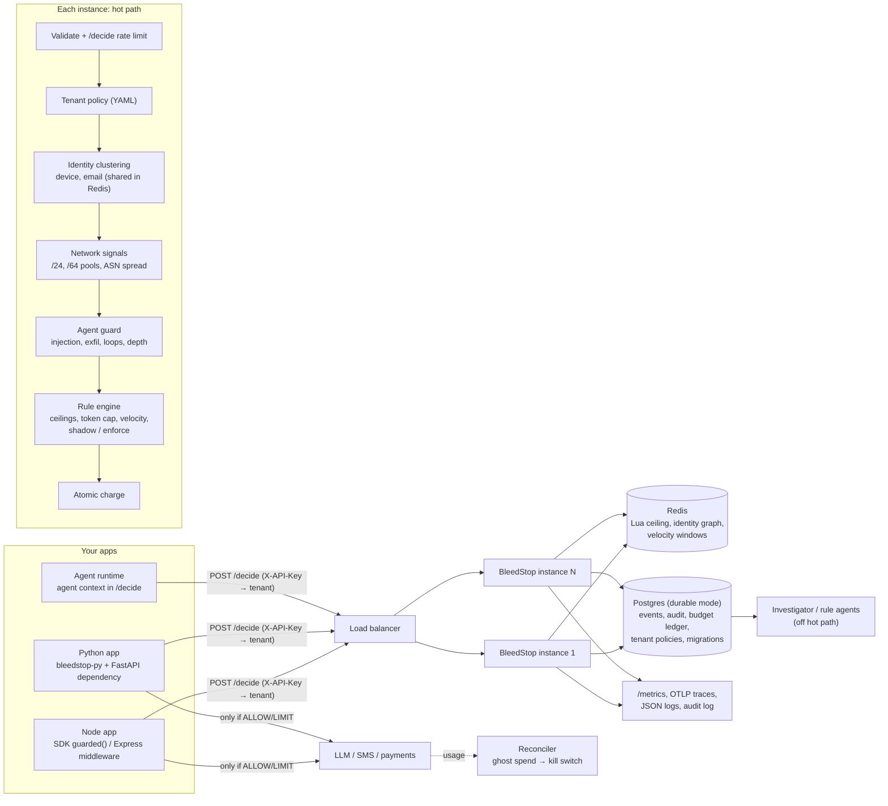

# BleedStop

**Cost-abuse and agent-abuse control plane for LLM, SMS and payment spend (OWASP LLM10 "Unbounded Consumption", plus LLM01/LLM06 checks for agents).**
Apps call `POST /decide` before spending. BleedStop returns `ALLOW | LIMIT | CHALLENGE | DENY` from deterministic, per-tenant rules; budgets are enforced per identity *cluster* and atomically across instances via Redis; agent calls are pre-checked for injection, exfiltration, tool loops and runaway recursion. Node SDK + Express middleware, Python async SDK + FastAPI dependency.

## Architecture


Decision order inside `/decide`: rate limit → validation → tenant policy → idempotency replay → cluster → OTP freeze / key kill switch → rules (agent guard, token cap, velocity, subnet pool, ASN spread, SMS rules, ceilings; DENY > CHALLENGE > LIMIT > ALLOW) → atomic charge → event, metrics, span, log.

Design decisions: `docs/adr/` (9 ADRs). Threat model: `docs/THREAT-MODEL.md`.

## Features
| Area | What exists |
|---|---|
| Abuse controls | Identity clustering (device, normalised email), per-cluster $ ceilings, token-aware cost and per-request token cap, per-cluster LLM velocity, subnet (/24, /64) pool budgets that scale with distinct actors, ASN spread (shadow by default), SMS rules, OTP freeze, leaked-key reconcile + kill switch |
| Agent security | Deterministic guard: injection families, markdown/URL exfiltration, secrets in network tool args, tool loop and velocity per session, recursion depth; `/agent/precheck` |
| Multi-tenant | API key → tenant (plain or sha256-hashed, timing-safe), per-tenant YAML policy (budgets, caps, thresholds, rate limits) validated at boot, `STRICT_READS` tenant isolation |
| Security | Strict /decide schema validation, token-bucket rate limit on /decide, 256 KB body cap, security headers, RBAC (viewer/operator/admin), audit log of every admin mutation |
| Scale | Redis Lua check-and-charge, shared identity graph, Redis velocity windows; graceful fallback to local mode on Redis failure; subnet pool / ASN state shared in Redis; Docker Compose 3x stack and Helm chart, both run and tested (results/INFRA-RESULTS.md) |
| Durable state | Postgres mode: versioned migrations with advisory lock, append only budget ledger and audit log (DB trigger), tenant policy snapshots, batched write behind (50 ms), survives a Postgres outage without failing /decide |
| Observability | Prometheus (/metrics incl. latency histogram, denied USD, degraded counter), OpenTelemetry spans exported over OTLP/HTTP, JSON decision logs |
| SDKs | Node (`guarded()` with idempotent dedupe incl. parallel retries, CHALLENGE blocks), Python `bleedstop-py` (httpx async, pydantic v2, FastAPI dependency, same fail policy) |
| Quality | Golden-set evals (precision/recall/F1/FP per scenario), agent evals with held-out set, attack suite, scale benchmark, all as CI gates; Node + Python test suites |

## Quick start
```bash
npm install && npm start                          # :3000
POLICY_FILE=config/policy.example.yaml npm start  # per-tenant policy
npm test && npm run evals && npm run evals:agent  # tests + eval gates
npm run attack-suite                              # mock-LLM red team
npm run bench:scale                               # needs redis-server on PATH
cd bleedstop-py && pip install -e ".[dev]" && pytest

# containers: 3x API + Redis + Postgres + nginx on :8080
docker compose -f docker-compose.stack.yml up -d --build
node evals/run-evals.js --url http://127.0.0.1:8080 --gate
BLEEDSTOP_URL=http://127.0.0.1:8080 npm run attack-suite
node benchmark/stack/load.js --url http://127.0.0.1:8080 --n 20000 --c 64
node src/db/migrate.js --status                  # DATABASE_URL set

# Kubernetes (kind, kube-proxy nftables), NodePort 30080
kind create cluster --config deploy/kind/cluster.yaml
kind load docker-image bleedstop:local --name bleedstop
helm install bs deploy/helm/bleedstop --wait     # needs metrics-server for the HPA
```
Probes: `/livez` (process only), `/readyz` (503 while booting or draining after SIGTERM).

## Measured results
## 1. Attack suite (`benchmark/attack-suite`, end to end through an app using the SDK, 3 runs, medians)

| Scenario | Requests | Original blocked | v0.4 patch blocked | v0.5 blocked | v0.5 upstream calls prevented | v0.5 $ saved per 1,000 calls |
|---|---:|---:|---:|---:|---:|---:|
| Normal users (FP) | 1000 | 0.0% | 0.0% | 0.0% | 0.0% | $0.00 |
| Farm, 100 accounts, one device | 2000 | 83.1% | 97.0% | 97.0% | 97.0% | $3.15 |
| Farm, 100 accounts, all signals rotated, one /24 | 2000 | 0.0% | 0.0% | 66.7% | 66.7% | $2.17 |
| Token flood, 400k chars | 200 | 0.0% | 100.0% | 100.0% | 100.0% | $252.00 |
| Retry storm, no key | 1000 | 66.2% | 94.0% | 94.0% | 94.0% | $3.05 |
| Retry storm, same idempotency key | 1000 | 0.0% | 0.0% | 0.0% | 99.9% | $3.25 |

Added latency (app → BleedStop → mock, 1,000 sequential): p50 1.16 ms, p95 1.43 ms. Throughput at concurrency 32: 678 req/s protected vs 916 direct.

## 2. Golden set evals (`evals/`, 12,140 labeled requests)

See EVAL-REPORT.md for all scenarios. Summary:

| Config | Overall precision | Overall recall | F1 | Benign FP rate | Rotated same /24 recall | Residential proxy one ASN recall | ISP users FP | Campus NAT FP |
|---|---:|---:|---:|---:|---:|---:|---:|---:|
| A original code | 85.9% | 61.4% | 71.6% | 31.4% | 83.1% | 83.1% | 43.7% | 66.2% |
| B current, ASN union on | 80.2% | 75.7% | 77.9% | 58.5% | 97.0% | 97.0% | 90.0% | 94.0% |
| C current default | 100.0% | 48.0% | 64.8% | 0.0% | 66.7% | 0.0% | 0.0% | 0.0% |
| D current, ASN spread enforce | 93.8% | 65.4% | 77.0% | 13.6% | 66.7% | 80.0% | 66.7% | 0.0% |

## 3. Agent guard (`evals/run-agent-evals.js`)

| Set | Detection (block) | FP (block) |
|---|---:|---:|
| Dev set 55/57 (tuned on) | 96.4% | 0.0% |
| Held-out 40/40 (never tuned on) | 22.5% | 0.0% |
| Tool sequences 7/5 | 100% | 0% |

Lexical classifier: no measurable lift.

## 4. Scale, Redis correctness, rate limit, degradation

Box: 8 vCPU, Node v20.19.2; load generator, LB and instances share the box. Load: 20,000 /decide calls, unique actors, concurrency 64, after 2,000 warmup calls; medians of 3 runs. Latency is client side through the LB. Correctness: 2,000 concurrent calls (concurrency 100) from one cluster against a $5 ceiling at $0.015 per call (flat price, velocity rule disabled), plus 200 unrelated actors that must get 200 distinct cluster ids. Worst case of 3 runs shown for correctness.

| Topology | Throughput req/s | p50 ms | p95 ms | p99 ms | Errors | Allowed (one cluster) | Max charged vs $5 | Max overspend | Unrelated actors, distinct ids (min) |
|---|---:|---:|---:|---:|---:|---:|---:|---:|---:|
| 1x memory | 3786 | 15.95 | 25.48 | 34.36 | 0 | 338 | $4.986 | $0.000 | 200/200 |
| 1x memory + OTel OTLP export | 2519 | 23.91 | 37.62 | 52.03 | 0 | 338 | $4.986 | $0.000 | 200/200 |
| 1x redis (atomic) | 3283 | 18.64 | 25.37 | 33.15 | 0 | 339 | $4.995 | $0.000 | 200/200 |
| 2x redis (atomic) + LB | 4957 | 11.89 | 27.11 | 36.30 | 0 | 333 | $4.995 | $0.000 | 200/200 |
| 3x redis (atomic) + LB | 6291 | 9.01 | 21.12 | 31.89 | 0 | 333 | $4.998 | $0.000 | 200/200 |
| 2x redis LEGACY (REDIS_ATOMIC=0) + LB | not measured | | | | | 342 | $5.130 | $0.130 | 100/200 |

/decide rate limit (100 req/s, burst 200, one caller): 1000 requests in 0.48s → 247 accepted (theoretical max 249), 753 answered 429.
Redis outage: redis-server SIGKILLed after request 1000 of 4000 → 4000 HTTP 200, 0 errors; process switched to local mode (bleedstop_degraded_redis_total = 32, one per in flight request at kill time).

## 5. Tests

* Node: 42 tests, 39 pass; the 3 failures need `data/kb/*.json`, which was not in the zip (RAG knowledge base).
* Python: 16 unit tests pass, `mypy --strict` clean; 2 end to end tests pass against a live server.
* Original portfolio benchmark: PASS. Drill: 3/3.

## 6. Docker, Postgres mode, Kubernetes (full detail: results/INFRA-RESULTS.md)

| Setup | Result |
|---|---|
| Compose 3x API + Redis + Postgres, golden set | 100% precision, 0% FP, recall 48.0%, same 4,414 TP as single process |
| Compose load, Postgres on / off | 5,433 / 5,844 decisions/s median, p99 36.2 / 38.8 ms, 0 failed |
| Postgres stopped ~7 s under load | 86,071 requests, 0 failed, 86,071 of 86,071 ledger rows persisted after restart |
| kind, 6 pods, rolling restart under load | 287,403 requests, 0 failed (31 failed with the readiness drain disabled) |
| kind, SIGKILL / force delete under load | 1 failed of 132,853 / 0 failed of 197,036 |
| kind, HPA | 3 to 6 pods under load |

Eight bugs were found only by running it (full graph rewrite per decision in the old Postgres path, per process
subnet pools under a load balancer, cross replica event id collisions, crash on Postgres disconnect, hanging pg
connects, unbounded boot hydration causing heap OOM, broken NetworkPolicy and probes in the chart, npm
swallowing SIGTERM). All are fixed and listed in results/INFRA-RESULTS.md.

## Not measured
* NetworkPolicy enforcement (kind's CNI did not enforce it); multi node or cloud clusters; Postgres HA.
* Real provider latency or pricing.
* Field accuracy: golden sets and rules share an author.
