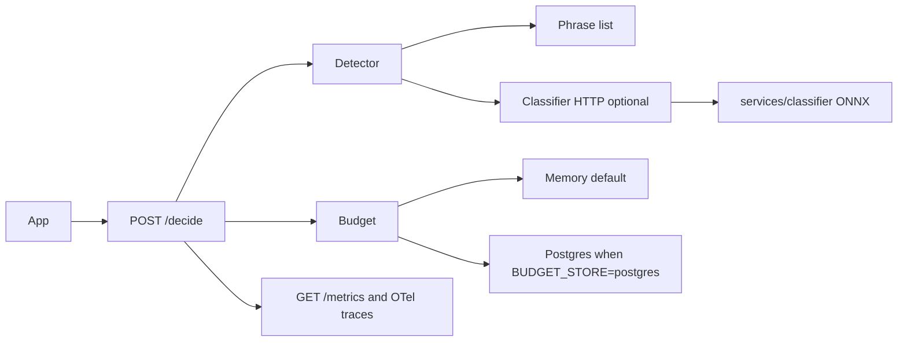
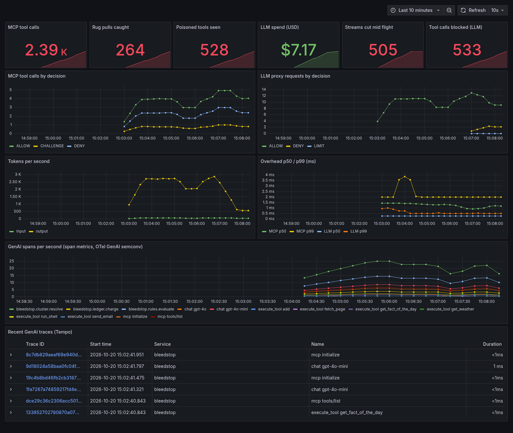
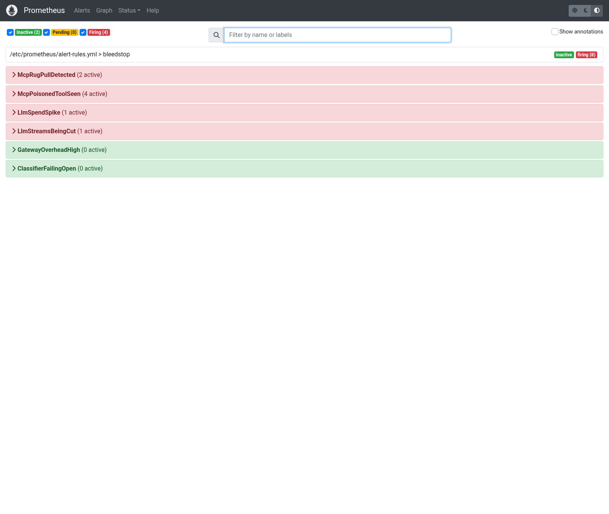

# BleedStop

**Cost abuse control plane for LLM, SMS and payment APIs (OWASP LLM10 "Unbounded Consumption").** Apps call `POST /decide` before they spend money; BleedStop answers `ALLOW | LIMIT | CHALLENGE | DENY` from deterministic, per tenant rules, enforced atomically across instances via Redis.

[](https://github.com/usmamalik345/bleedstop/actions/workflows/ci.yml)
[](https://github.com/usmamalik345/bleedstop/actions/workflows/terraform.yml)
[](https://github.com/usmamalik345/bleedstop/actions/workflows/cd-ghcr.yml)
**Project site:** https://usmamalik345.github.io/bleedstop/ · **Enterprise overview:** [README-enterprise.md](README-enterprise.md) · **Measured results:** [results/](results/) · **ADRs:** [docs/adr/](docs/adr/)

### Live demo API
**[https://bleedstop-demo.vercel.app](https://bleedstop-demo.vercel.app/)** (interactive demo page; API health at [/api/health](https://bleedstop-demo.vercel.app/api/health)) with a public, demo only key `demo-public-key` (tenant `demo`, in memory, no real providers).
```bash
curl -s -X POST https://bleedstop-demo.vercel.app/decide \
  -H "Content-Type: application/json" -H "X-API-Key: demo-public-key" \
  -d '{"actorId":"demo-user-1","action":"llm.call","paid":false,"estimatedTokens":500,"signals":{"deviceFingerprint":"fp-demo-1"}}'
# => "decision":"ALLOW"   (set "estimatedTokens":400000 => "decision":"DENY", unpaid token cap 32000)
```
> **Serverless caveat (honest):** the demo runs on Vercel Hobby functions with in memory state and no Redis/Postgres. State lives per function instance, so budgets, velocity windows and rate limits can reset on cold starts or when requests hit different instances; the $5 cluster ceiling is not reliably enforced across calls here. The measured numbers above come from the Docker Compose / Kubernetes stack with Redis, not from this demo. Admin and operator endpoints require dashboard login.

### Measured, not estimated (raw JSON in [`results/`](results/))
| What | Result |
|---|---|
| 3 instances + Redis atomic ceiling + LB | **6,291 decisions/s**, p99 **31.9 ms**, $0.000 overspend vs a $5 ceiling ([SCALE-RESULTS](results/SCALE-RESULTS.md)) |
| Kubernetes `rollout restart` of 6 pods under load | **287,403 requests, 0 failed**, p99 33.2 ms ([INFRA-RESULTS](results/INFRA-RESULTS.md)) |
| Postgres stopped ~7 s mid load | 86,071 requests, 0 failed, 0 ledger rows dropped |
| Golden set evals (12,140 labeled requests) | precision 100%, benign FP rate 0.0%, recall 48.0% ([EVAL-REPORT](results/EVAL-REPORT.md)) |
| Attack suite | 400k char token flood 100% blocked, shared device farm 97%, retry storm 94%, normal users 0% blocked |
| Agent guard | dev set 96.4%; held out set **22.5%** (the honest number), 0% FP ([AGENT-EVAL-REPORT](results/AGENT-EVAL-REPORT.md)) |

Includes: Node SDK + Express middleware, Python SDK (`bleedstop-py`, FastAPI dependency), multi tenant YAML policy, Redis scale out, Postgres durable mode, Prometheus + OpenTelemetry, Docker Compose stack and Helm chart.

---

## Original overview
**Abuse cost control plane** for Node apps: stop bot farms and leaked API keys from burning SMS/LLM budgets.

This repo is built as a **portfolio / staging control plane**, not a click-toy.  
Paid actions ask BleedStop before money leaves. Decisions are **deterministic rules**. Agents only explain.

## What problem it solves

Small SaaS apps get hit by:
- OTP / SMS pumping
- Free-tier AI abuse across many fake accounts
- Leaked browser/API keys that spend **outside** your app

Vendor tools protect one slice (Twilio-only, OpenAI-only, Stripe-only). BleedStop tracks **$ per abuse cluster across actions** and reconciles **ghost spend**.

## Architecture

```text
Your SaaS  --SDK/middleware-->  BleedStop /decide  --> ALLOW | LIMIT | DENY
                                      |
                                 cluster ledger
                                      |
                    reconcile (app ledger vs vendor usage)
                                      |
                         investigator + rule proposals (off hot path)
```



The phrase list is the default detector. The ONNX sidecar runs only when `BLEEDSTOP_DETECTOR` is `classifier` or `both`. The check in the browser on the demo page is a demo only. It does not protect the API.

## Quick start (portfolio benchmark)

```bash
npm install
npm start          # control plane :3000
```

New terminal:

```bash
npm run app        # protected SaaS sample :4000
```

New terminal:

```bash
npm run benchmark  # red-team numbers for your README
```

Dashboard: http://localhost:3000/dashboard/  
Checkout (Stripe test): http://localhost:4000/checkout.html

## Benchmark results (portfolio proof)

Run yourself: `npm run benchmark` (needs `npm start` + `npm run app`).

| Scenario | Without | With BleedStop | Saved |
|----------|--------:|---------------:|------:|
| OTP / SMS pumping | $6.00 | $1.60 | **$4.40** |
| Free AI credit abuse | $9.00 | $3.39 | **$5.61** |
| Card testing / payment attempts | $4.00 | $0.00 | **$4.00** |
| Leaked key ghost spend | $55.00 | — | **$55.00** (key disabled) |
| **Total** | **$74.00** | | **~$69 saved** |

## Drop into YOUR real Express app

```js
import { createClient, protectPaidAction } from "./src/sdk/express.js";

const bleedstop = createClient({ baseUrl: process.env.BLEEDSTOP_URL });

app.post(
  "/otp",
  protectPaidAction(bleedstop, { action: "sms.send" }),
  sendOtpHandler
);
```

See:
- [`apps/protected-saas/server.js`](./apps/protected-saas/server.js) — full sample (OTP, AI, Stripe checkout)
- [`apps/my-saas-starter/server.js`](./apps/my-saas-starter/server.js) — minimal copy-paste starter
- [`docs/INTEGRATE-YOUR-APP.md`](./docs/INTEGRATE-YOUR-APP.md) — step-by-step for your own Express app

```bash
npm run my-app   # starter on :4100
```

## Stripe (test mode)

1. Add `STRIPE_SECRET_KEY` + `STRIPE_PUBLISHABLE_KEY` to `.env`
2. Open http://localhost:4000/checkout.html — test card `4242 4242 4242 4242`
3. Webhooks sync confirmed payments to app ledger:

```bash
stripe listen --forward-to localhost:3000/webhooks/stripe
# put whsec_... in .env as STRIPE_WEBHOOK_SECRET, restart npm start
```

See [`docs/STRIPE-WEBHOOKS.md`](./docs/STRIPE-WEBHOOKS.md).

## FastAPI (Python) sample

Same BleedStop guard, Python stack for portfolio:

```bash
pip install -r apps/protected-saas-python/requirements.txt
npm start          # control plane :3000
npm run app:py     # FastAPI :5000
```

- App: http://localhost:5000  
- Swagger: http://localhost:5000/docs  
- Guide: [`apps/protected-saas-python/README.md`](./apps/protected-saas-python/README.md)
- Sprint notes: [`docs/SPRINT-CEILINGS-RULES.md`](./docs/SPRINT-CEILINGS-RULES.md)

```bash
npm run test:py              # pytest (mocked BleedStop)
npm run worker:reconciler:py # Python reconcile loop → Slack on ghost
```

Ceilings: unpaid `$UNPAID_CEILING_USD` (default 5) vs paid `$PAID_CEILING_USD` (default 50).  
Dashboard → Rules: toggle **shadow ↔ enforce**.

## Phase A (advanced portfolio)

- Multi-tenant `X-API-Key` → tenant routing ([docs/PHASE-A.md](./docs/PHASE-A.md))
- Slack alert on ghost-spend kill switch (`SLACK_WEBHOOK_URL`)
- Dashboard charts: cluster spend + ALLOW/LIMIT/DENY
- GitHub Actions CI (Node 18/20 → lint + test)

## Live OpenAI mode (optional, real money)

1. Put a **restricted** key in `.env`:
   ```env
   OPENAI_API_KEY=sk-...
   OPENAI_MODEL=gpt-4o-mini
   ```
2. Restart `npm run app`
3. `/ai/rewrite` calls **real OpenAI**, still behind BleedStop middleware
4. Keep a hard provider budget alert/limit on the key

Without the key, app runs **offline stub mode** (same protection path, no external spend).

## Real Postgres

```bash
npm run db:up
# .env already has DATABASE_URL
npm start
```

Health should show `"storage":"postgres"`.

## Kubernetes

See `deploy/README.md` (kind + Helm: API, HPA, NetworkPolicy, CronJob reconcile).

## Portfolio docs

- [PORTFOLIO.md](./PORTFOLIO.md) — how to present this in interviews
- [docs/HOW-IT-WORKS-URDU.md](./docs/HOW-IT-WORKS-URDU.md) — short Roman Urdu explanation
- [docs/REAL-DATABASE.md](./docs/REAL-DATABASE.md) — persistence

## Scripts

| Script | Purpose |
|--------|---------|
| `npm start` | Control plane + dashboard |
| `npm run app` | Protected SaaS sample + checkout UI (Express :4000) |
| `npm run app:py` | Protected SaaS sample (FastAPI :5000) |
| `npm run test:py` | Pytest for FastAPI client + routes |
| `npm run worker:reconciler:py` | Python ghost-spend reconciler loop |
| `npm run my-app` | Minimal “your app” integration starter |
| `npm run benchmark` | Attack benchmark + $ saved table |
| `npm test` | Unit tests |
| `npm run db:up` | Postgres + Redis |
| `npm run stack:up` | Full docker compose |

## v2 features (MCP gateway, classifier, OpenAI proxy, observability)

All numbers below are **local benchmarks** on one Linux box (Node 20, CPU only, in memory state, mock or in process upstreams). They are not production measurements. Raw output lives in `results/`.

### 1. MCP security gateway with policy as code

`POST /mcp/:server` (streamable HTTP JSON-RPC) and `bin/mcp-gateway-stdio.js` (stdio) sit in front of MCP tool servers. Every `tools/call` goes through, in order: definition pin check (TOFU sha256 over name, description, inputSchema, annotations), tool description poisoning scan, per tenant Cedar policy (`config/mcp-policy.cedar`, `@effect("challenge")` maps to CHALLENGE), the agent injection guard on arguments, then the normal BleedStop `decide()` budget. Tool results are scanned for indirect injection. `MCP_GATEWAY_MODE=shadow` logs decisions without blocking. OWASP Agentic Top 10 (ASI01 to ASI10) mapping with honest coverage is in `docs/THREAT-MODEL.md`.

| Measure (`npm run evals:mcp`, 70 hand written tool definitions) | Result |
|---|---|
| Poisoning scan precision / recall / FPR | 100% / 80% (20 of 25) / 0% (0 of 45) |
| Rug pull detection | 180 of 180 mutations caught, 0 false alarms on 45 unchanged re lists |
| Added latency per tools/call over HTTP, n=2000 | p50 2.21 ms, p95 2.84 ms, p99 3.89 ms |

Misses are subtle, polite poisonings with no trigger phrase (5 of 25). The eval set was written by us, so treat recall as optimistic.

### 2. Trained injection classifier (second stage)

`classifier/server.py` serves `protectai/deberta-v3-base-prompt-injection-v2` (FastAPI). With `CLASSIFIER_URL` set, `/agent/precheck` and the MCP gateway run regex first, then the classifier. The older timeout name is `CLASSIFIER_TIMEOUT_MS`. Full table: `results/CLASSIFIER-REPORT.md` (`npm run bench:classifier`).

The server can also call a small ONNX sidecar (`services/classifier/`, CPU, same 8 bit model the browser demo loads). It stays off until `BLEEDSTOP_DETECTOR` is set to `regex`, `classifier`, or `both`. `both` runs the phrase list first and sends only allowed text to `POST /classify`. Timeout is `BLEEDSTOP_CLASSIFIER_TIMEOUT_MS` (default 800). If the sidecar is down or slow, `BLEEDSTOP_CLASSIFIER_FAILMODE=open` (the default) keeps the phrase-list verdict, logs a warning, and increments `bleedstop_classifier_errors_total`. `closed` turns that outage into a block: safer against injection, but a dead sidecar then stops those calls. The browser check on the demo page is a demo only. It does not protect the API. The server detector is the real check, and the live demo still uses the phrase list until the flag is set.

| Set | Regex recall / FPR | Classifier recall / FPR | Two stage recall / FPR |
|---|---|---|---|
| deepset/prompt-injections, all 662 | 4.2% / 0% | 41.4% / 1.0% | 41.4% / 1.0% |
| BleedStop held out, 80 | 22.5% / 0% | 77.5% / 5.0% | 80.0% / 5.0% |
| BleedStop dev (regex tuned on it), 112 | 96.4% / 0% | 83.6% / 7.0% | 96.4% / 7.0% |

Latency on 4 CPU threads: regex p50 about 9 us; classifier p50 about 46 to 49 ms, p99 55 to 132 ms. Caveats: deepset includes German rows and the model is English only; training overlap with public sets cannot be ruled out; the PINT row in the report is the public 8 row example file, not a PINT score; Llama Prompt Guard 2 is gated and was not evaluated.

### 3. OpenAI compatible proxy

Point an OpenAI SDK at `<bleedstop>/v1`. `POST /v1/chat/completions` (streaming and not), `POST /v1/responses`, `GET /v1/models`. Each request reserves budget for prompt plus capped output, DENY returns 429 and CHALLENGE 403 in OpenAI error shape, LIMIT downgrades to the small model. The output cap is the smallest of requested, `OPENAI_PROXY_MAX_OUTPUT_TOKENS` (1024) and remaining budget, and is enforced mid stream even if the upstream ignores `max_tokens`. Reservations are committed with actual usage. Model `tool_calls` go through Cedar and the agent guard. The live demo uses a deterministic mock upstream; set `OPENAI_PROXY_UPSTREAM` for a real one.

| Measure (`npm run bench:openai`, mock upstream over HTTP) | Result |
|---|---|
| Added latency, n=1000 non streaming | p50 1.53 ms, p99 1.86 ms |
| Streaming flood: 40 requests for 20,000 words, upstream ignores max_tokens | 40 of 40 streams cut mid flight; $10.70 would be billed unprotected vs $0.41 through the proxy ($10.29 prevented) |

Pricing in the flood uses the policy rate of $0.01 per 1k tokens with tokens approximated as chars/4.

**Real upstream (Groq free tier, `openai/gpt-oss-20b`, small run):** over 20 pairs of non streaming calls, direct p50 was 245.8 ms and through BleedStop p50 was 234.2 ms. Proxy overhead was not measurable over internet noise at this size; the mock number above is the overhead estimate. With a 64 token cap, a streaming 1500 word request dropped from 2618 completion tokens direct to 64 through BleedStop, because Groq honoured the rewritten `max_tokens` (BleedStop's own mid stream cut was not needed). Reconciled cost at the policy rate fell from $0.0271 to $0.00151 per request. The actual bill was $0 (free tier). Full method and caveats: `results/REAL-UPSTREAM-REPORT.md`. Every other proxy number in this section is against the mock.

**Classifier on the live demo (in browser):** free Docker hosting for the sidecar was not available (Hugging Face Docker Spaces need PRO). The demo can instead run the same DeBERTa v2 model in the visitor's browser with onnxruntime-web, using an 8 bit weight only build (256 MB, served from GitHub Pages, loaded only on click). Against the fp32 ONNX it gave identical labels on the held out, dev and deepset test sets. Single threaded inference took p50 245 ms in headless Chrome on the build box. That browser check is a demo only. It does not protect the API. Server side enforcement on the live demo remains the phrase list until `BLEEDSTOP_DETECTOR` is set. Details: `results/BROWSER-CLASSIFIER-REPORT.md`.

### 4. OpenTelemetry GenAI spans and observability stack

Spans follow the OTel GenAI semantic conventions: `chat {model}` with `gen_ai.operation.name`, `gen_ai.provider.name`, `gen_ai.request.model`, `gen_ai.usage.input_tokens/output_tokens`, and `execute_tool {name}` with `gen_ai.tool.name`. `deploy/observability/` holds a Docker Compose stack (OTel Collector with span metrics, Tempo, Prometheus with 6 alert rules, Grafana with a provisioned dashboard). Run `npm run obs:up`, start BleedStop with `OTEL_EXPORTER_OTLP_ENDPOINT=http://localhost:4318`, then `npm run obs:traffic`.

Screenshots are in the Observability section below.

## Observability



*Grafana dashboard from the local stack in deploy/observability, fed by real local traffic against the mock OpenAI upstream and the demo MCP servers.*



*Prometheus alert rules from the same local stack, with four of six firing during the mock upstream traffic run.*

## Results

Each file below was written by a script in this repo. Open the file for N, p50, p95, the machine, and the command.

| Report | What it measured |
|---|---|
| [results/LOADTEST-REPORT.md](results/LOADTEST-REPORT.md) | Added latency of BleedStop versus a local mock upstream on the same machine (`npm run loadtest`) |
| [results/MULTI-INSTANCE-REPORT.md](results/MULTI-INSTANCE-REPORT.md) | 3 replicas and Postgres, short race from GitHub Actions job `kind-race` |
| [results/INJECTION-EVAL.md](results/INJECTION-EVAL.md) | Phrase-list recall and false positive rate on dev, held-out, and deepset (`npm run eval:injection`) |
| [results/CLASSIFIER-REPORT.md](results/CLASSIFIER-REPORT.md) | Earlier torch classifier run. The injection eval above did not rerun the sidecar |
| [results/BROWSER-CLASSIFIER-REPORT.md](results/BROWSER-CLASSIFIER-REPORT.md) | In-browser demo model. Not the server check |

On 2026-10-20 the load test (`results/LOADTEST-REPORT.md`, Windows, 11th Gen Intel Core i7-1185G7, 8 threads) recorded this added latency (BleedStop sample percentile minus the mock sample percentile):

| Scenario | N | added p50 ms | added p95 ms | added p99 ms | correct |
|---|---:|---:|---:|---:|---|
| normal_users | 25455 | 2.722 | 4.131 | 6.719 | 25455/25455 |
| leaked_key_flood | 17900 | 5.479 | 6.958 | 9.6 | 17900/17900 |
| retry_storm | 28993 | 2.622 | 2.97 | 3.7 | 28993/28993 |
| token_flood | 26879 | 2.269 | 3.414 | 5.183 | 26879/26879 |

A call that also waits on a real model provider is dominated by that provider. The table above removes the provider. It is the overhead of BleedStop on this machine only.

The same injection script, phrase list only, cutoff 0.6, normaliser off: dev recall 53/55 (N=112, benign 57, FPR 0/57), held-out 9/40 (N=80, FPR 0/40), deepset test 1/60 (N=116, FPR 0/56), deepset train 10/203 (N=546, FPR 0/343). Lowering the cutoff to 0.3 did not raise dev recall and raised dev FPR to 1/57, so the cutoff stayed 0.6. Normalising did not raise dev recall. The classifier sidecar was not running, so this script did not measure it.

The 3-replica race was not run on this Windows machine (Docker is not installed here). GitHub Actions job `kind-race` ran `node deploy/k8s/race.js --url http://127.0.0.1:3000 --n 80` on linux, AMD EPYC 7763 x 4, Node v20.20.2, 2026-10-20T19:54:22.016Z. Ceiling $1. N=80, errors 0, ALLOW 2, LIMIT 58, DENY 20, charged $0.574, max spendAfter $0.574, over ceiling: no. Full row: `results/MULTI-INSTANCE-REPORT.md`.

## Limits

- The server classifier is off unless `BLEEDSTOP_DETECTOR` is set. This README's injection table is the phrase list.
- The browser classifier on the demo does not enforce anything on the server.
- `BLEEDSTOP_NORMALIZE` is off. On the dev set it did not raise recall.
- Postgres is optional (`BUDGET_STORE=postgres`). Memory is still the default store. One short 3-replica race is in `results/MULTI-INSTANCE-REPORT.md` (N=80 on the CI runner). It is not a long load test.
- The identity graph in `src/cluster.js` is shared inside one process. Budgets and idempotency keys are per tenant. Two tenants do not share dollars. They can still share a cluster id in that process.
- Admin login can use a generic OIDC issuer (`OIDC_ISSUER`). This is not SAML. The Keycloak compose file was not started here.
- Grafana Cloud is documented as env vars only in `docs/OBSERVABILITY.md`. No account was created. Metrics stay on `GET /metrics`. Traces are sent only if `OTEL_EXPORTER_OTLP_ENDPOINT` is set.
- The public stats panel on the demo (`GET /api/public-stats`) counts one process for the last hour. It is not a count of every visitor.
- The live demo on Vercel Hobby keeps state in memory for that instance. A cold start or another instance does not share the budget.
- End-to-end latency with a real provider is mostly the provider. Use the load-test table for BleedStop's added time.

## Honest scope

- Control plane, SDK, clustering, rules, ghost reconcile, RAG investigator, K8s chart: **implemented**
- Mock vendor bills used when no live keys (still valid for abuse-control engineering)
- Live OpenAI path: **optional via env**
- Live Twilio: wire the same middleware around your Twilio call (pattern already in `/auth/otp`)
