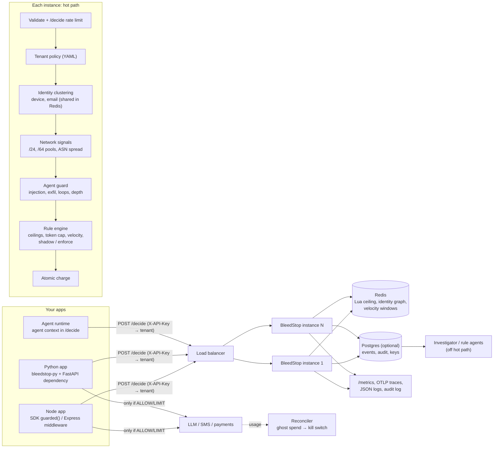

# Architecture

Decision order inside `/decide`: rate limit → validation → tenant policy → idempotency replay → cluster → OTP freeze / key kill switch → rules (agent guard, token cap, velocity, subnet pool, ASN spread, SMS rules, ceilings; DENY > CHALLENGE > LIMIT > ALLOW) → atomic charge → event, metrics, span, log.
